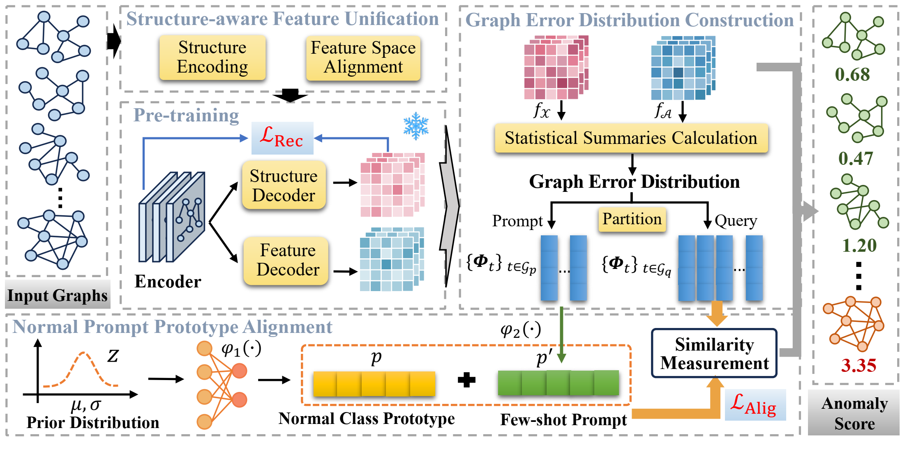

# Generalist Graph-Level Anomaly Detection via Graph Error Distribution Prototype Learning (OFA-GLAD)



## Requirments
This code requires the following:
* Python>=3.8
* PyTorch>=1.12.1
* Numpy>=1.24.4
* Scipy>=1.10.1
* Scikit-learn>=1.3.2
* DGL==0.9.0 

## Running the experiments
```
python main.py
```
